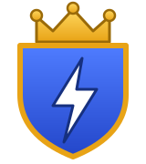
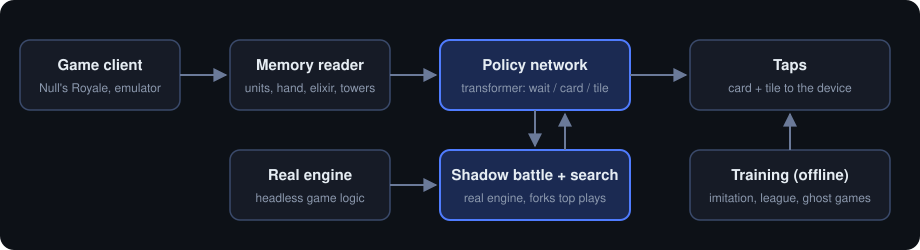

<div align="center">



# HastyCR


**Offline research into a Clash Royale agent: a memory reader, a transformer policy trained on replays and self-play, and a search that forks the real game logic before each play.**

[How it works](#how-it-works) · [Results](#results) · [Findings](#findings) · [Layout](#layout) · [Run it](#run-it) · [Limits](#limits)

</div>

> [!IMPORTANT]
> HastyCR is a research project. It has only been tested on **Null's Royale**, a private server, and is not meant for use on official Supercell servers. No game binaries, assets or extracted engine files are in this repository.

<br>

## How it works

<p align="center"></p>

1. **Read.** A small native reader on the emulator copies the battle from the client's memory every frame: units, positions, hit points, hand, elixir and towers. No screen vision.
2. **Decide.** A transformer policy (`tools/league/model.py`) takes the board as tokens and chooses wait, a card, or a hero ability, then a tile on an 18x32 grid.
3. **Search (experimental).** A *shadow battle* mirrors the live match inside the real game logic, run headless. Before a play, it forks the battle for the model's top tiles and cards, simulates about 10 seconds each, and keeps the best result minus the elixir spent.
4. **Act.** The chosen card and tile become taps on the device. Menus between battles are navigated automatically.

Training happens offline, in the same headless engine:

| Stage | What it does |
|---|---|
| Imitation | Learns from ~250k public replays and ~120k ultimate-champion replays, re-played in the engine so every row matches real game state. |
| League | PPO against a pool of past models and ladder meta decks, with a held-out opponent that is never trained against. |
| Ghost games | Human winners' plays become scripted opponents; the model learns to beat what strong players actually did. |

<br>

## Results

| What | Number |
|---|---|
| Best live result | **Champion league** on Null's Royale |
| Engine bench, no search | 86.8% vs held-out opponent (200 games) |
| Engine bench, tile search on the exact board | **93.5%** (200 games) |
| Engine bench, tile + card search with elixir cost | 92.8%, and **78.3%** against itself |
| Simulator check | an unblocked Hog Rider's seven tower hits reproduced exactly |

Engine numbers use the real game logic with the exact board. Live, the search runs on a reconstructed copy of the board, and that copy is not yet accurate enough (see [Limits](#limits)).

<br>

## Findings

Things this project measured, some of them the hard way:

- **Search helps only as much as the board it searches.** On the exact board, search gains about 7 points. On a reconstructed board, it overrode the model on most plays and lost games. Fidelity comes first.
- **Short forks undervalue buildings.** A 10-second look-ahead sees a Furnace's cost but little of its value, so buildings now get placement search only.
- **Searching when the model wants to wait is harmful.** It drops the win rate from 93% to 62%: the bot plays too much.
- **Engine head-to-head wins do not predict the ladder.** Every model step "won" its engine gate at about 55%, yet a later model stalled live while the earlier one reached Champion.
- **A sampled play/wait choice costs about 20 points.** Near-greedy (temperature 0.1) is used everywhere.
- **Unconstrained RL collapses.** Without a KL anchor and with a large learning rate, a strong model was wrecked in 20 updates.
- **Imitation models never play at low temperature** unless the wait bias is recalibrated after every fine-tune.
- **The memory reader is not always about you.** In some battles the "played cards" list belongs to the opponent; deck learning now ignores cards outside the deck.

<br>

## Layout

| Path | What it is |
|---|---|
| `scripts/gamestate/live_play.py` | The live bot: reader frame, model, search, taps, auto-queue. |
| `scripts/gamestate/memread.py`, `native/` | Memory reader; the C sources build the on-device reader. |
| `scripts/gamestate/live_bridge.py` | Reader frame to the model's input. |
| `scripts/gamestate/nav.py` | Menu navigation between battles. |
| `scripts/emulator.py` | Which emulator instance may be driven. |
| `tools/league/model.py`, `obs.py` | The policy network and its input. |
| `tools/league/actor.py`, `learner.py` | Self-play matches and the PPO learner. |
| `tools/league/realsim.py` | The headless real engine behind a simulator interface. |
| `tools/league/shadow_live.py`, `shadow_search.py` | Shadow battle and live search. |
| `tools/league/engine_bc.py` | Imitation on replays re-played in the engine. |
| `tools/royale_scrape.py` | Replay scraper. |
| `docs/` | Handoff notes, scraping, card audit and probe protocols. |

<br>

## Run it

The headless engine, models and replay data are not in the repository; the commands below assume you built or collected them yourself.

```powershell
# live bot (model only)
.venvs\royalegym\Scripts\python.exe scripts\gamestate\live_play.py --ckpt <model.pt> --heroes ElectroWizard --no-tactical-guards --no-lane-guard --no-cap-rule

# add the experimental search
... --shadow-search --record-frames 10
```

The deck and its order are read from game memory, never passed on the command line.

<br>

## Limits

- The shadow battle drifts from the live game: on recorded games it still predicts tower damage worse than assuming towers do not change. Live search stays experimental until that is fixed.
- The search's fork opponent does not play cards.
- Hero ability buttons are derived from the board, not read from memory.
- Memory offsets are per client build (`scripts/gamestate/offsets.json`).

<br>

<div align="center"><sub>MIT license · offline research · not affiliated with or endorsed by Supercell</sub></div>
